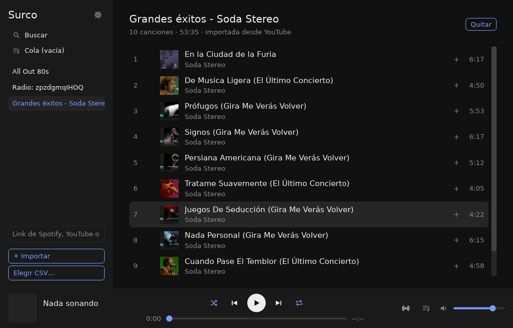
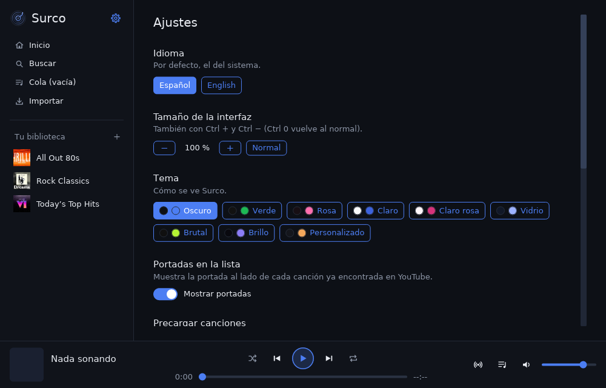

# Surco

Surco es un reproductor de música para la computadora, liviano y gratuito. Pegás el link de una playlist de Spotify o de YouTube y Surco la reproduce buscando cada canción en YouTube. No hace falta cuenta de Spotify Premium ni de ningún otro servicio.

Funciona en **Linux**, **Windows** y **macOS** (Intel y Apple Silicon).



## Qué podés hacer

- **Importar playlists** de Spotify, YouTube o YouTube Music pegando el link, o desde un archivo CSV.
- **Buscar** canciones, artistas y playlists de YouTube sin salir de la app: los resultados aparecen mientras escribís.
- **Armar tus playlists**: creá las tuyas, agregá canciones desde el buscador o desde otras playlists, cambiales el nombre y ordenalas arrastrando.
- **Descubrir canciones**: al final de cada playlist hay recomendaciones parecidas para sumarle.
- **Escuchar sin cortes**: la próxima canción se prepara mientras suena la actual.
- **Música sin fin**: si escuchás desde el buscador, Surco va sumando canciones parecidas a la cola para que nunca se termine.
- **Radio**: armá una lista de canciones parecidas a la que está sonando.
- **Editar la cola**: agregá, quitá y reordená canciones arrastrándolas.
- **Elegir otro video** si Surco encontró una versión equivocada de una canción (en vivo, cover, etc.).
- **Usar las teclas multimedia** del teclado y los controles de música del sistema.
- **Escuchar sin conexión**: la flechita de una playlist baja todas sus canciones y las deja guardadas.
- **Cambiar el tema**: oscuro, verde, rosa, claro, claro rosa, **vidrio** (fondo de colores con paneles translúcidos), **brutal** (bordes duros y acento lima), **brillo** (oscuro con resplandor violeta) o uno **personalizado** con tus dos colores.
- **Español o inglés**: elegí el idioma en los ajustes (de entrada usa el de tu computadora).

Todo lo que importás queda guardado en tu computadora: playlists, videos elegidos, historial y ajustes. La pantalla de **Inicio** te muestra tus playlists y lo último que escuchaste.

## Instalación

### Ubuntu, Debian y derivadas: una sola línea

Abrí una terminal y pegá:

```sh
curl -fsSL https://devmathiux.github.io/Surco/install.sh | sudo sh
```

Esto agrega el repositorio de Surco e instala la app. Después se actualiza sola con el resto del sistema (`sudo apt upgrade` o el Actualizador de software), y para volver a instalarla alcanza con `sudo apt install surco`. Seguí con el [paso 3](#3-instalar-yt-dlp-y-deno).

<details>
<summary>Prefiero hacerlo a mano</summary>

```sh
sudo install -d -m 0755 /etc/apt/keyrings
sudo curl -fsSL https://devmathiux.github.io/Surco/surco.gpg -o /etc/apt/keyrings/surco.gpg
echo "deb [arch=amd64 signed-by=/etc/apt/keyrings/surco.gpg] https://devmathiux.github.io/Surco stable main" \
  | sudo tee /etc/apt/sources.list.d/surco.list
sudo apt update
sudo apt install surco
```

</details>

Para el resto de los sistemas (o si preferís bajar el archivo), seguí los pasos de abajo.

### 1. Descargar Surco

Entrá a [Releases](https://github.com/devMathiuX/Surco/releases) y bajá, de la última versión, el archivo que corresponde a tu sistema:

| Sistema | Archivo |
|---|---|
| Windows 10 u 11 | `Surco-<versión>-windows-x64-setup.exe` (instalador) o `…-portable.zip` (sin instalar) |
| macOS 11 o más nuevo | `Surco-<versión>-macos-universal.dmg` |
| Ubuntu, Debian, Linux Mint, Pop!_OS | `surco_<versión>-1_amd64.deb` |
| Cualquier otro Linux | `Surco-<versión>-x86_64.AppImage` |

### 2. Instalarlo

<details open>
<summary><b>Windows</b></summary>

1. Abrí el `setup.exe` que bajaste. No pide permisos de administrador.
2. Si aparece **"Windows protegió su PC"** (SmartScreen), hacé clic en **Más información** y después en **Ejecutar de todas formas**. El aviso sale porque Surco no está firmado con un certificado pago, no porque tenga algo malo.
3. Seguí los pasos del instalador. Surco queda en el menú Inicio.

Si preferís no instalar nada, descomprimí el `.zip` portable y abrí `surco.exe`.

</details>

<details>
<summary><b>macOS</b></summary>

1. Abrí el `.dmg` y arrastrá **Surco** a la carpeta **Aplicaciones**.
2. La primera vez, macOS no la deja abrir con doble clic porque Surco no está registrado en Apple. Hacé **clic derecho sobre Surco > Abrir**, y en el aviso, **Abrir** otra vez. Desde la segunda vez abre normal.
3. Si macOS dice que la app **"está dañada"**, abrí la app Terminal y pegá este comando:

   ```sh
   xattr -dr com.apple.quarantine /Applications/Surco.app
   ```

   Después abrila de nuevo.

</details>

<details>
<summary><b>Linux</b></summary>

**Con el repositorio (Ubuntu, Debian y derivadas, recomendado):** ver [arriba](#ubuntu-debian-y-derivadas-una-sola-línea). Así recibís las actualizaciones solas.

**Con el `.deb` (Ubuntu, Debian y derivadas):** abrí una terminal en la carpeta de descargas y corré:

```sh
sudo apt install ./surco_*.deb
```

Surco aparece en el menú de aplicaciones.

**Con el AppImage (cualquier distro):**

```sh
chmod +x Surco-*.AppImage
./Surco-*.AppImage
```

Hace falta una distro de 2022 o más nueva (por ejemplo Ubuntu 22.04 o Debian 12).

</details>

### 3. Instalar yt-dlp y deno

Surco usa dos programas gratuitos para sacar el audio de YouTube: **yt-dlp** y **deno**. No tenés que instalar nada a mano: si falta alguno, al abrir Surco aparece un aviso con el botón **Descargar**, que los baja de sus páginas oficiales a la carpeta de Surco. Después Surco los mantiene actualizados solo, cada vez que lo abrís.

Si preferís instalar deno por tu cuenta:

| Sistema | Cómo instalar deno |
|---|---|
| Windows | En PowerShell: `irm https://deno.land/install.ps1 \| iex` |
| macOS | Con [Homebrew](https://brew.sh): `brew install deno`. Sin Homebrew, en la Terminal: `curl -fsSL https://deno.land/install.sh \| sh` |
| Linux | En una terminal: `curl -fsSL https://deno.land/install.sh \| sh` |

Después cerrá y volvé a abrir Surco. Si ya tenés `node` o `bun` instalados, Surco los usa y deno no hace falta.

## Cómo se usa


### Importar una playlist

Entrá a **Importar** en la barra lateral (o apretá **Ctrl+L**), pegá el link y apretá **Enter** o **Importar**. Sirven:

- **Spotify:** `https://open.spotify.com/playlist/…` (el link de "Compartir > Copiar enlace").
- **YouTube y YouTube Music:** `https://www.youtube.com/playlist?list=…`, `https://music.youtube.com/playlist?list=…` o un video que esté dentro de una playlist.
- **Un archivo CSV:** con el botón **Elegir CSV…**. Por ejemplo, uno exportado desde [Exportify](https://exportify.net).

La playlist queda guardada en la barra lateral y sus portadas van apareciendo solas. Hacé clic en una canción para escucharla: Surco busca el video en YouTube y sigue sola con las demás.

**Playlists de Spotify grandes:** se importan enteras, aunque tengan miles de canciones, incluso las hechas por Spotify (como "All Out 80s"). Surco las lee igual que la web de Spotify cuando no iniciaste sesión, así que no hace falta cuenta, Premium ni claves. Si alguna vez solo trae las primeras 100, probá de nuevo más tarde o importá un CSV de Exportify.

### Buscar música


Escribí en el buscador del **Inicio** o entrá a **Buscar** en la barra lateral. Mientras escribís aparecen sugerencias (clic en una para buscarla) y, cuando dejás de escribir, canciones, artistas y playlists. Volver a algo que ya buscaste es instantáneo.

- Clic en una **canción** para escucharla. Surco sigue con canciones parecidas, así que la música no se corta.
- Clic en un **artista** para ver sus canciones más escuchadas.
- Clic en una **playlist** para verla, escucharla o **Guardar en la biblioteca**.
- El **+** al lado de cada canción (o un clic derecho sobre ella) la agrega a la cola o a una de tus playlists.

### Retomar donde quedaste

Al abrir Surco, la última canción que escuchaste queda cargada en pausa, en el punto donde la dejaste. Su audio queda guardado en tu compu, así que al darle a play suena al instante.

### Tus playlists

- **Crear una:** el **+** al lado de "Tu biblioteca", en la barra lateral, o "+ Nueva playlist" en el menú del **+** de cualquier canción.
- **Agregar canciones:** el **+** de una canción, o clic derecho sobre ella (en el buscador, en otra playlist o en el inicio), y elegí la playlist.
- **Quitar una canción:** el **+** de la canción dentro de la playlist, y **Quitar de…**.
- **Cambiar el nombre:** el lápiz al lado del nombre, o clic derecho sobre la playlist en la barra lateral > **Renombrar**. También sirve para guardar una radio: con nombre deja de reemplazarse por la próxima.
- **Cambiar el orden:** arrastrá la playlist en la barra lateral.
- **Descargarla para escucharla sin conexión:** la **flechita** de arriba a la derecha de la playlist. Se pone del color de acento y baja las canciones de a una (al lado ves cuántas van). Si la tocás de nuevo, te deja **borrar las descargas**.
- **Quitarla:** la **×** de arriba a la derecha. Las canciones descargadas que no estén en otra playlist descargada se borran del disco.
- **Más opciones:** clic derecho sobre una playlist en la barra lateral para renombrarla, borrar sus descargas o quitarla. Los menús se abren al lado del mouse.
- **Buscar dentro de una playlist:** el buscador de arriba de la lista (Ctrl+F te lleva ahí).
- **Recomendadas:** al final de cada playlist hay canciones parecidas. **Agregar** la suma a la playlist, un clic la escucha, y **Otras** trae más.

### La cola de reproducción

Abrila con **Cola** en la barra lateral o con el botón de la lista en la barra de abajo. Ahí ves la canción actual y las que siguen:

- **Arrastrá** una canción para cambiarla de lugar.
- La **×** la saca de la cola.
- Un **clic** la pone a sonar.

### Si suena la versión equivocada

Cuando Surco no está seguro de haber encontrado la canción correcta, la marca como **"dudosa"** en la lista. Hacé clic en "dudosa", o en el botón de **cambiar video** de la barra de abajo (un video con flechas alrededor), y elegí otro video de la lista. Surco recuerda tu elección.

### Radio

El botón de ondas de la barra de abajo arma la playlist "Radio" con unas 25 canciones parecidas a la que suena. En **Ajustes**, la opción **"Al terminar, seguir con canciones parecidas"** (prendida de entrada) arranca una radio sola cuando se termina la cola.

### Actualizaciones

Al abrir Surco, si hay internet, se fija si salió una versión nueva. Si hay, aparece un aviso abajo a la izquierda con **Instalar**: baja la versión que corresponde a cómo lo instalaste (instalador o portable en Windows, AppImage, `.deb` o portable en Linux) y Surco se reinicia solo. Con el `.deb`, el sistema pide tu contraseña; si tu sistema no tiene `pkexec`, se abre una terminal para que la escribas ahí (y si tampoco hay terminal, Surco te muestra el comando para copiarlo). En macOS se abre el `.dmg` para que arrastres la app a Aplicaciones.

### Bandeja de Windows

En Windows, la X esconde la ventana y Surco sigue sonando en la bandeja (la flechita al lado del reloj). Tocá el ícono para volver a abrirlo. Con clic derecho podés pausar o **Salir** del todo.

### Ajustes



La primera vez que abrís Surco aparece una pantalla de bienvenida para elegir el tema, el idioma, el tamaño y la precarga. Tocá **Empezar** y listo; todo se puede cambiar después.

El engranaje de arriba a la izquierda abre los ajustes:

- **Idioma:** español o inglés. De entrada, español si tu computadora está en español, e inglés si no.
- **Tamaño de la interfaz:** de 70 % a 160 %, para agrandar o achicar todo.
- **Tema** de colores. Con **Personalizado** elegís el fondo y el acento: tocá una muestra o escribí el color (`#1E2A3A`). Los demás colores salen solos de esos dos.
- **Portadas en la lista** de canciones.
- **Precargar canciones:** baja de antemano las próximas 5 canciones, o toda la playlist, para que no haya que esperar ni dependan de la conexión. Usa hasta 2 GB de disco y dura lo que dura la sesión: se borra al cerrar Surco. **Vaciar** la borra en el momento. Lo único que queda guardado de una vez para otra son las playlists descargadas con la flechita, hasta que borres sus descargas, quites la playlist o saques la canción de ella.
- **Spotify:** claves propias de la Web API, opcionales (ver abajo).

### Atajos de teclado

| Atajo | Acción |
|---|---|
| Espacio | Reproducir / pausar |
| ← / → | Retroceder / adelantar 5 segundos |
| Ctrl+← / Ctrl+→ | Canción anterior / siguiente |
| Ctrl+L | Importar una playlist (pegar un link) |
| Ctrl+F | Ir al buscador de la playlist abierta |
| Ctrl++ / Ctrl+− / Ctrl+0 | Agrandar / achicar / tamaño normal de la interfaz |
| Esc | Borrar la búsqueda en la playlist y cerrar el selector de video o los menús |

Un clic en el parlante de la barra de abajo silencia; otro clic vuelve al volumen de antes. Si la ventana es angosta, la barra de volumen aparece al pasar el mouse por el parlante.

En macOS, usá **Cmd** en lugar de Ctrl. Las teclas multimedia del teclado también funcionan, y Surco aparece en los controles de música del sistema (el panel de medios de Windows, "Está sonando" en macOS y el widget de música en Linux).

## Solución de problemas

**"No encontré yt-dlp"**
Hacé clic en **Descargar yt-dlp**. Si falla, instalalo a mano siguiendo las [instrucciones de yt-dlp](https://github.com/yt-dlp/yt-dlp/wiki/Installation) y volvé a abrir Surco.

**Las canciones no suenan o dan error una tras otra**
- Revisá que tengas internet.
- Instalá deno (paso 3 de la instalación) y reiniciá Surco.
- Actualizá yt-dlp: YouTube cambia seguido y las versiones viejas dejan de andar. Si lo bajó Surco, borralo de la carpeta de datos (ver abajo) y Surco va a ofrecer bajarlo de nuevo. Si lo instalaste vos, corré `yt-dlp -U`.
- Con VPN o desde algunas redes (trabajo, universidad), YouTube puede pedir "confirmar que no sos un bot". Probá sin VPN o desde otra red.

**Una canción suena en vivo, como cover o es otra canción**
Usá **Cambiar video** y elegí la correcta (ver [Si suena la versión equivocada](#si-suena-la-versión-equivocada)).

**De una playlist de Spotify solo se importaron 100 canciones**
Pasa si Spotify no respondió a la lectura completa. Esperá un rato y volvé a importarla (pegá el mismo link). Si sigue igual, importala como CSV desde [Exportify](https://exportify.net) o, si tenés Spotify Premium, cargá tus claves en **Ajustes > Spotify**.

**Algunas playlists de Spotify no se importan**
Las playlists privadas y los mixes personales (como "Daily Mix" o "Descubrimiento semanal") no se pueden leer sin tu cuenta. Copiá las canciones a una playlist pública tuya y probá con esa, o usá Exportify.

**En Windows o macOS aparece un aviso de seguridad al abrir**
Es normal, porque Surco no está firmado con un certificado pago. Ver los pasos de [instalación](#2-instalarlo).

### Dónde guarda Surco tus datos

| Sistema | Carpeta |
|---|---|
| Windows | `%APPDATA%\Surco\data\` |
| macOS | `~/Library/Application Support/Surco/` |
| Linux | `~/.local/share/surco/` |

Ahí están la biblioteca (`surco.db`), yt-dlp si lo bajó Surco, y la carpeta `logs` con los registros de los últimos 7 días. Si reportás un problema, adjuntá el log del día.

## Preguntas frecuentes

**¿Es gratis? ¿Necesito cuenta?**
Sí, es gratis, y no necesitás cuenta de Spotify, YouTube ni de nada.

**¿De dónde sale el audio?**
De YouTube. Spotify solo se usa para leer la lista de canciones de una playlist.

**¿Necesito claves de Spotify?**
No. Surco importa las playlists públicas enteras sin claves. Las claves de la Web API quedan como respaldo opcional, pero Spotify ahora pide **Premium** para crear una app de desarrollador. Si tenés Premium y querés usarlas: entrá al [panel de desarrolladores de Spotify](https://developer.spotify.com/dashboard), creá una app (cualquier nombre, y como Redirect URI `http://127.0.0.1:8888/callback`), y copiá el **Client ID** y el **Client secret** en **Ajustes > Spotify > Guardar**.

**¿Cómo desinstalo Surco en Linux si lo instalé con la línea de `curl`?**
`sudo apt remove surco`. Si además querés sacar el repositorio: `sudo rm /etc/apt/sources.list.d/surco.sources /etc/apt/keyrings/surco.gpg`.

**¿Funciona sin internet?**
Solo con las canciones que ya precargaste (ver Ajustes).

## Para desarrolladores

Cómo compilar Surco, cómo está armado por dentro y las decisiones técnicas: [docs/DEVELOPMENT.md](docs/DEVELOPMENT.md).

## Aviso legal

El uso de contenido de YouTube y de Spotify queda bajo responsabilidad de cada usuario y de los términos de servicio de cada plataforma. Surco no aloja ni redistribuye contenido.
