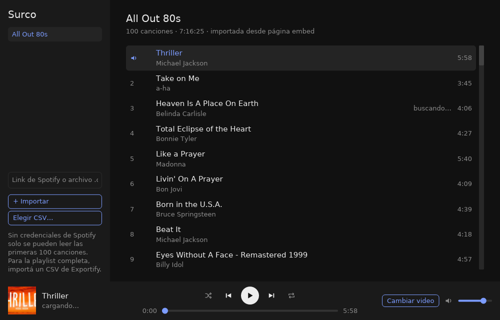
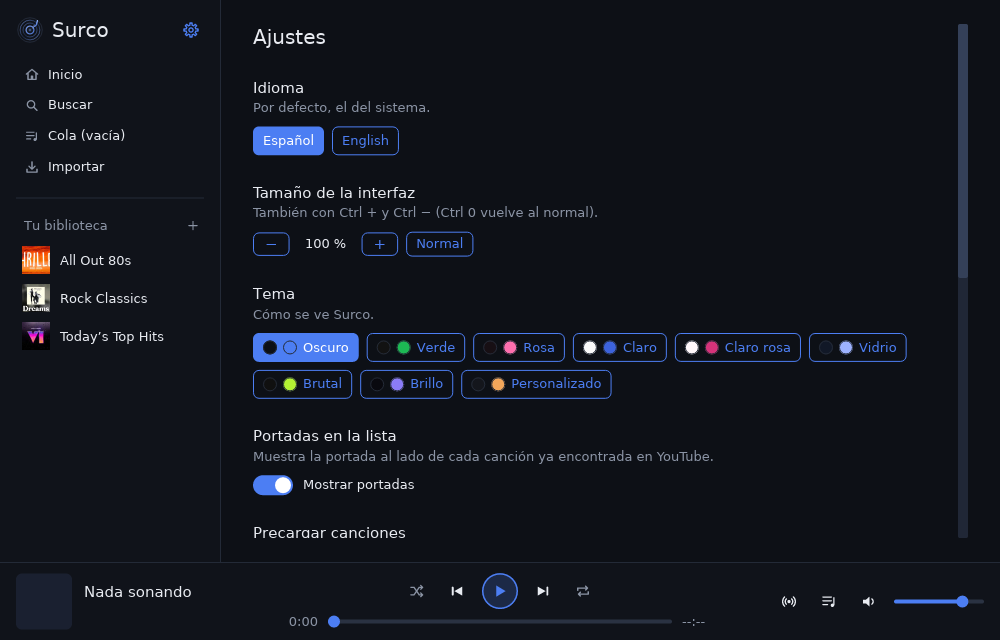

# Surco: notas de desarrollo

Detalles técnicos de Surco: cómo compilarlo, cómo está armado y qué se midió. La guía para usuarios está en el [README](../README.md).

## Releases y CI

- **CI** (`.github/workflows/ci.yml`): en cada PR y push a `main` corre en Linux `cargo fmt`, `clippy`, los tests y el build release.
- **Release** (`.github/workflows/release.yml`): compila y empaqueta en Linux, Windows y macOS. Corre solo con un tag `v*` (y entonces publica un Release de GitHub con todos los archivos y sube el `.deb` al repositorio APT) o a mano desde la pestaña Actions ("Run workflow"), que deja los paquetes como artefactos del run.
- Para publicar una versión: subir `version` en `[workspace.package]` de `Cargo.toml`, y después `git tag v0.6.4 && git push origin v0.6.0`.

| Archivo | Sale de |
|---|---|
| `surco_<v>-1_amd64.deb` | `cargo deb -p surco` |
| `Surco-<v>-x86_64.AppImage` | `packaging/linux/build-appimage.sh` |
| `surco-<v>-linux-x86_64.tar.gz` | binario + `.desktop` + ícono |
| `Surco-<v>-windows-x64-setup.exe` | Inno Setup (`packaging/windows/surco.iss`) |
| `Surco-<v>-windows-x64-portable.zip` | `surco.exe` + README |
| `Surco-<v>-macos-universal.dmg` | `packaging/macos/build-app.sh` (lipo + codesign ad hoc) |

Los binarios de Linux se compilan en Ubuntu 22.04 (glibc 2.35) para que corran en distros no tan nuevas.

### Repositorio APT (`sudo apt install surco`)

Después de crear el Release, `release.yml` llama a **`apt.yml`**, que baja el `.deb` del Release y lo publica en un repositorio APT firmado, servido por GitHub Pages desde la rama `gh-pages`:

- URL: `https://devmathiux.github.io/Surco` (suite `stable`, componente `main`, solo `amd64`).
- Lo arma `packaging/linux/build-apt-repo.sh` con `apt-ftparchive`: parte de lo publicado en `gh-pages`, agrega el `.deb` nuevo y deja las últimas 3 versiones (`SURCO_APT_KEEP`). Firma `InRelease` y `Release.gpg`, y exporta la clave pública como `surco.gpg` y `surco.asc`.
- También deja `install.sh` (instalador de una línea, `packaging/linux/apt/install.sh`) y `apt/index.html` con las instrucciones. La raíz del sitio es la página de Surco (ver abajo).
- `gh-pages` se reescribe con un solo commit en cada publicación, así los `.deb` viejos no quedan en la historia. Las versiones viejas siguen en Releases.
- Se puede publicar un Release existente a mano: Actions > **Repo APT** > Run workflow, con el tag (por ejemplo `v0.3.0`).
- Si falta el secreto `APT_GPG_PRIVATE_KEY`, el job avisa y no publica (el Release sale igual).

### Página web (`https://devmathiux.github.io/Surco`)

La página de Surco vive en `web/` (un solo `index.html` sin dependencias, con las capturas en `web/img/`) y comparte la rama `gh-pages` con el repo APT:

- `web/build.sh <sitio> <url-base>` copia la página sobre lo publicado sin tocar `dists/`, `pool/`, `install.sh` ni las claves, escribe `release.json` con el último Release (con `gh api`), deja la versión y los links de ese Release escritos en el HTML (`web/stamp.py`) y arma `apt/index.html`.
- **`pages.yml`** la publica cuando cambia `web/` en `main` (o a mano: Actions > **Página** > Run workflow). `apt.yml` también corre `web/build.sh` después de cada Release, así los links de descarga apuntan a la versión nueva. Los dos workflows comparten el grupo de concurrencia `apt-repo` para no pisarse.
- La página detecta el sistema (Windows, macOS, Linux) y arma los links de descarga con `release.json`; si falta, usa la API de GitHub, y sin JavaScript manda a la página del último Release. Textos en español en el HTML y en inglés en el `<script>` (`EN`).
- Para probarla local: `web/build.sh /tmp/sitio http://localhost:8000 && python3 -m http.server -d /tmp/sitio`.

**Configuración, una sola vez:**

1. Crear la clave de firma, sin contraseña (en Linux; en Windows sirve Git Bash, que trae `gpg`):

   ```sh
   gpg --batch --passphrase '' --quick-gen-key "Surco APT <163420138+devMathiuX@users.noreply.github.com>" rsa4096 sign never
   gpg --armor --export-secret-keys "Surco APT" > surco-apt-privada.asc
   ```

2. En GitHub: Settings > Secrets and variables > Actions > **New repository secret**, nombre `APT_GPG_PRIVATE_KEY`, y pegar todo el contenido de `surco-apt-privada.asc`. Si la clave tiene contraseña, agregarla en `APT_GPG_PASSPHRASE`.
3. Guardar `surco-apt-privada.asc` en un lugar seguro, fuera del repo. Si se pierde, hay que crear otra y cada usuario tiene que volver a correr `install.sh` para tomar la clave nueva.
4. Correr Actions > **Repo APT** > Run workflow con `v0.3.0`. Crea la rama `gh-pages` e intenta activar Pages solo.
5. Si Pages no quedó activo: Settings > Pages > Source **Deploy from a branch**, rama `gh-pages`, carpeta `/ (root)`.

**Probarlo localmente** (con una clave de prueba en un `GNUPGHOME` aparte):

```sh
packaging/linux/build-apt-repo.sh <carpeta-con-.deb> site http://127.0.0.1:8765
(cd site && python3 -m http.server 8765) &
curl -fsSL http://127.0.0.1:8765/install.sh | sudo sh
```

## Requisitos para compilar

- Rust estable ≥ 1.88 (`rustup`).
- **Linux:** para compilar, `libasound2-dev` (ALSA; en Debian/Ubuntu `sudo apt install libasound2-dev`, en Fedora `alsa-lib-devel`). Para correr, X11 o Wayland con `libxkbcommon` (viene con cualquier escritorio).
- **Windows:** toolchain MSVC. Nada más.
- **macOS:** las Xcode Command Line Tools (`xcode-select --install`). Nada más. Los atajos con Ctrl usan Cmd.
- [`yt-dlp`](https://github.com/yt-dlp/yt-dlp): si no está en el `PATH`, la app ofrece descargarlo de los releases oficiales a su carpeta de datos (`~/.local/share/surco/` en Linux, `%APPDATA%\Surco\data\` en Windows, `~/Library/Application Support/Surco/` en macOS). `ffmpeg` no hace falta por ahora.
- Un runtime de JavaScript para yt-dlp: desde fines de 2025 yt-dlp lo necesita para YouTube. Recomendado [`deno`](https://deno.com); si no está, Surco usa `node`, `bun` o QuickJS si los encuentra en el `PATH`.

## Cómo correrlo

```sh
cargo run                 # debug
cargo run --release       # release (opt-level 3)
cargo build --profile release-z   # variante optimizada para tamaño
```

## Probar el audio (Fase 2)

1. `cargo run --release`
2. El campo ya trae un link de prueba ("Big Buck Bunny", Blender Foundation, CC BY). Apretá **Reproducir** (o Enter).
3. Espacio pausa y reanuda; ←/→ mueven 5 s; la barra de progreso también hace seek; el volumen está a la derecha.

El campo acepta también un ID de video, una URL directa a un `.m4a` o una ruta local, útil para probar sin YouTube.

Variables de entorno útiles:

- `RUST_LOG=surco=debug` para más detalle en los logs.
- `SURCO_NULL_AUDIO=1` para correr sin placa de sonido (descarta el audio en tiempo real; lo usan los tests).

## Importar playlists (Fase 3)

En la pantalla **Importar** (o con **Ctrl+L**), pegá cualquiera de estos y Enter / **Importar**:

- `https://open.spotify.com/playlist/{id}` (con o sin `?si=…`, también `/intl-es/…` y `/embed/…`)
- `spotify:playlist:{id}`
- la ruta a un `.csv` exportado con [Exportify](https://exportify.net)

Surco prueba tres estrategias en cascada (trait `PlaylistSource` en `crates/spotify`):

1. **Reproductor web sin sesión** (`webplayer.rs`, ver "Spotify sin claves" más abajo). Playlist entera, con álbum, sin cuenta ni claves. Es la vía normal.
2. **Página embed pública** (`open.spotify.com/embed/playlist/{id}`), sin credenciales. Lee el JSON que trae embebido (`__NEXT_DATA__`). Trae título, artistas y duración, pero **no** álbum ni ISRC, y **solo las primeras 100 canciones** (la app lo avisa). No es una API pública: puede romperse si Spotify cambia el HTML.
3. **CSV** (Exportify, formato viejo y nuevo, o uno hecho a mano con `title,artist,album,duration`). Trae la playlist completa con álbum e ISRC. Sirve si las otras fallan.

Si una estrategia dice que la playlist no existe (404 de la embed o `NotFound` del reproductor web), la cascada corta ahí.

## Resolver Spotify → YouTube (Fase 4)

Clic en una canción de la playlist: Surco la busca en YouTube, la reproduce y resuelve de antemano las 3 siguientes (como mucho 3 búsquedas a la vez). Al terminar pasa sola a la siguiente; **Ctrl+←/→** va a la anterior/siguiente. Si una canción falla, la saltea con un aviso; después de 3 errores seguidos frena (típico cuando YouTube bloquea la red).

Cómo elige el video (`crates/resolver`):

1. **Limpia el título**: saca "- Remastered 2011", "(Remastered 2009)", "- Radio Edit", "- From \"Footloose\"", "[From …: Original Score]"; separa los "(feat. X)", "(with X)", "ft. X". Lo que marca otra versión ("- Live", "(Versión Reggae)", "- Acústico") se conserva.
2. **Busca** `"{artista principal} - {título}"` con `yt-dlp "ytsearch5:…" --flat-playlist --dump-json` (no resuelve cada video, es rápido).
3. **Puntúa** cada candidato de 0 a 100:
   - Duración (35): ±3 s puntaje completo; baja hasta 15 s; más de 30 s de diferencia resta.
   - Título (30): el título limpio aparece en el del video, o similitud Jaro-Winkler (`strsim`).
   - Artista (20): en el título o en el canal.
   - Canal (15): "Artista - Topic", VEVO, canal oficial, o "Official Audio" en el título.
   - Penalización (40 por palabra, tope 60): live, cover, karaoke, 8D, slowed, sped up, reverb, nightcore, remix, instrumental, 432 Hz… **salvo** que el original también lo diga (con sinónimos: "en vivo" = "live", "acústico" = "unplugged").
4. Si el mejor queda **por debajo de 60**, hace una segunda búsqueda (`"… audio"`) y suma esos candidatos. Si sigue abajo de 60, la canción se marca **"dudosa"** en la lista: clic en "dudosa" (o **Cambiar video** en la barra de abajo) muestra los candidatos con su puntaje para elegir otro a mano.

Los matches se guardan en SQLite (ver Fase 6).

### Evaluación (`tools/eval_resolver`)

```sh
cargo run -p eval_resolver --release                       # necesita yt-dlp e internet
cargo run -p eval_resolver --release -- --report /tmp/r.tsv  # además, un TSV con todos los candidatos
```

`songs.csv` tiene 50 canciones tomadas tal cual de 4 playlists públicas de Spotify (80s, clásicos del rock con títulos "Remaster", rock en español y hits actuales con "feat." y "[From GTAVI]"). `labels.txt` tiene, para cada una, los videos que cuentan como correctos, etiquetados a mano con este criterio: la grabación de estudio correcta (Topic, audio oficial, video con letra o video oficial con el audio de estudio), a menos de ~15 s de la duración de Spotify; no cuentan en vivo, covers, remixes, otras ediciones ni afinación alterada.

Resultados del 2026-11-24 (las búsquedas de YouTube cambian entre corridas):

| Corrida | Correctas | Notas |
|---|---|---|
| 1 (sin etiquetas) | 49/50 a ojo | Rocket Man eligió una versión "432hz": se agregó a las penalizaciones. |
| 2 | 45/50 (90 %) | Los 5 ✗ eran videos correctos nuevos que no estaban en las etiquetas; se agregaron. |
| 3 y 4 | 50/50 (100 %) | |
| 5 | 49/50 (98 %) | Otra vez un video correcto sin etiquetar; se agregó. |

Resolver las 50 tarda ~25 s (3 búsquedas en paralelo). Si un ✗ resulta ser un video correcto que no estaba en la lista, se agrega a `labels.txt`.

## Reproductor (Fase 5)



- **Barra inferior:** portada, título y artista, shuffle, anterior, play/pausa, siguiente, repetir (apagado → toda la playlist → una canción), barra de progreso con tiempos, volumen y "Cambiar video".
- **Cola:** clic en una canción arma la cola desde ahí. Con shuffle se mezcla todo menos la actual (Fisher-Yates); con "repetir todo" se vuelve a mezclar en cada vuelta. "Anterior" con más de 3 s reproducidos vuelve al principio de la canción.
- **Sin silencio entre canciones:** se resuelven de antemano las próximas 3 y el motor abre y decodifica la siguiente mientras suena la actual; al terminar, la pega sin corte (test `preloaded_track_follows_without_gap`).
- **Errores:** si una canción falla se saltea con un aviso discreto; después de 3 errores seguidos (por ejemplo, sin internet) frena.
- **Portadas:** la miniatura del video de YouTube, recortada al cuadrado (sin las franjas negras) y guardada en 64 y 256 px en la caché (`~/.cache/surco/covers/`, `%LOCALAPPDATA%\Surco\cache\covers\`). Sin credenciales Spotify no da la portada del álbum, así que se usa siempre la de YouTube.
- **Controles del sistema:** con [`souvlaki`](https://crates.io/crates/souvlaki). En Linux aparece como `org.mpris.MediaPlayer2.surco` (teclas multimedia, widget de GNOME/KDE, `playerctl`); en Windows, en el panel de medios (SMTC); en macOS, en "Está sonando". `SURCO_NO_MEDIA_KEYS=1` los desactiva.
- **Importar CSV:** botón "Elegir CSV…" (diálogo nativo con `rfd`; en Linux usa el portal de XDG).

| Atajo | Acción |
|---|---|
| Espacio | Play / pausa (sin nada sonando, arranca la playlist abierta) |
| ← / → | −5 s / +5 s |
| Ctrl+← / Ctrl+→ | Anterior / siguiente |
| Ctrl+L | Pantalla Importar |
| Ctrl+F | Buscar en la playlist (sin distinguir mayúsculas ni tildes) |
| Esc | Cerrar la búsqueda o el selector de video |

En macOS, Ctrl es Cmd. Los controles del sistema aparecen en el Centro de control ("Está sonando"). Los íconos se dibujan con `canvas` para no depender de qué fuentes tenga el sistema.

Medido en la Fase 5 (Linux, Xvfb, playlist de 100 canciones importada, 10 resueltas, portadas cargadas): **~24 MB de RAM**. Binario release: **12,3 MB** (sube por `image`, `souvlaki` + `zbus` y `rfd`).

## Biblioteca y caché (Fase 6)

Todo se guarda en un archivo SQLite (`rusqlite` con SQLite embebido, sin dependencias del sistema):

| SO | Base de datos | Logs |
|---|---|---|
| Linux | `~/.local/share/surco/surco.db` | `~/.local/share/surco/logs/` |
| Windows | `%APPDATA%\Surco\data\surco.db` | `%LOCALAPPDATA%\Surco\data\logs\` |
| macOS | `~/Library/Application Support/Surco/surco.db` | `~/Library/Application Support/Surco/logs/` |

- **Playlists:** se guardan al importarlas; reimportar la misma la reemplaza en su lugar. "Quitar" la saca de la biblioteca.
- **Matches:** cada canción resuelta (o con video elegido a mano) se guarda con sus candidatos. Al reabrir, la segunda reproducción no vuelve a buscar en YouTube, y "Cambiar video" sigue mostrando las opciones.
- **Historial:** cada canción que empieza a sonar (hasta 5.000 entradas).
- **Ajustes:** volumen, shuffle, repetir y la playlist abierta.
- **Logs:** un archivo por día, se guardan los últimos 7. `RUST_LOG=surco=debug` da más detalle.
- El esquema se versiona con `PRAGMA user_version`; una versión vieja de Surco no abre una base más nueva (avisa en el log y sigue sin guardar).
- Las URLs de audio de YouTube no se guardan en disco: vencen a las ~6 h y se piden de nuevo en ~1 s.
- `SURCO_DB=/ruta/a/otra.db` usa otra base (útil para probar).

Medido en la Fase 6 (Linux, Xvfb, playlist de 100 canciones restaurada desde la base): **~27-30 MB de RAM** y ~2,8 % de CPU reproduciendo. Binario release: **12,3 MB** (ver "Perfil release").

## Empaquetado (Fase 7)

```
packaging/
├─ icons/     surco.ico, surco.icns, PNG de 16 a 1024 px (make_icons.py los genera)
├─ linux/     surco.desktop, build-appimage.sh, build-apt-repo.sh y apt/ (el .deb lo arma cargo-deb, ver crates/app/Cargo.toml)
├─ windows/   surco.iss (Inno Setup)
└─ macos/     Info.plist, build-app.sh (lipo + codesign ad hoc + .dmg)
```

- El `.exe` lleva el ícono y los datos de versión embebidos (`crates/app/build.rs` con `winresource`) y no abre consola.
- La ventana usa el ícono en Linux y Windows; en macOS lo pone el `.app`.
- **Licencias:** Surco es MIT (`LICENSE`). Cada paquete lleva `LICENSE` y `THIRD_PARTY_LICENSES.html`, la lista de dependencias con el texto de cada licencia, que arma `cargo about generate --locked about.hbs -o THIRD_PARTY_LICENSES.html` en el workflow de release (`about.toml` lista las licencias aceptadas; si entra una dependencia con otra licencia, el paso falla). No se versiona (`.gitignore`): para correr `cargo deb` o los scripts de empaquetado a mano, generalo antes (`cargo install cargo-about --locked --features cli`). El botón **Ajustes > Acerca de > Licencias** (`crates/app/src/licenses.rs`) lo busca al lado del ejecutable, en `../share/doc/surco/` (.deb, AppImage) o en `../Resources/` (macOS), y si no está abre la sección Licencia del README.
- El `.deb` depende solo de `libasound2` y `libxkbcommon0`, y *sugiere* `yt-dlp` y `deno`. No los pide como dependencia porque el yt-dlp de las distros suele estar viejo y YouTube lo rompe.

Medido en la Fase 7 (Linux, Xvfb, binario release con la biblioteca de 100 canciones guardada):

| | Valor | Límite |
|---|---|---|
| Binario | **13,8 MB** | < 15 MB |
| `.deb` | 4,3 MB | |
| RAM al abrir | **~24 MB** | < 80 MB |
| RAM reproduciendo, portadas cargadas | ~27-30 MB | < 80 MB |
| Arranque hasta la ventana visible | **35-55 ms** (6 corridas) | < 1 s |
| CPU reproduciendo | ~2,8 % | |

Tamaños en los otros sistemas (workflow Release, paso "Tamaños"): `surco.exe` **8,6 MB** (`.zip` portable 4,2 MB); macOS **7,9 MB** en Apple Silicon y 8,7 MB en Intel (`.dmg` universal de 9,0 MB). En Linux pesa más por `zbus` (MPRIS) y el portal de archivos de XDG.

## Ajustes, temas, precarga y radio



El engranaje de arriba a la izquierda abre los ajustes. Todo se guarda en la biblioteca.

- **Temas:** Oscuro (el de siempre), Verde (estilo Spotify), Rosa, Claro, Claro rosa y Personalizado. Se cambian al instante. Los colores viven en `crates/app/src/theme.rs` (`THEMES`); agregar uno es sumar una entrada (y su nombre en `name_of`). El personalizado (`theme::CUSTOM`, índice `THEMES.len()`) se arma con `derive(fondo, acento)`: las superficies salen de aclarar u oscurecer el fondo según su luminancia, el texto es claro u oscuro según el fondo y `on_accent` según el acento. Se guarda como `theme = custom`, `theme_background` y `theme_accent` (`#RRGGBB`). El tema activo es un `RwLock<&'static Colors>`: cada color nuevo se filtra con `Box::leak` (~150 bytes) para que `colors()` siga devolviendo una referencia estática.
- **Idioma** (`crates/app/src/i18n.rs`): español o inglés, en un `AtomicBool` global como el tema. Los textos se eligen con `tr!("es", "en")` y `trf!("formato es", "formato en", args)`. Por defecto sale de `sys-locale`: español si empieza con `es`, inglés si no; se guarda como `language`. Los errores que vienen de los crates (importador, yt-dlp) siguen en español.
- **Portadas en la lista:** muestra la miniatura al lado de cada canción ya encontrada en YouTube (las demás, un cuadro vacío hasta que se buscan). Se bajan de a 4 y quedan en la caché de portadas.
- **Sin cortes entre canciones:** además de pre-cargar la siguiente en memoria, el decodificador se saltea el silencio del principio (hasta 10 s) y del final de cada video, que en YouTube suele sonar como un hueco entre canciones. El silencio del medio de una canción se respeta (test `skips_leading_and_trailing_silence`).
- **Precargar canciones:** "Las próximas 5" o "Toda la playlist" bajan el audio a disco antes de que suene, de a una canción por vez, así no hay que esperar a que cargue ni depende de la red en ese momento. Van a `~/.cache/surco/audio/` (`%LOCALAPPDATA%\Surco\cache\audio\`, `~/Library/Caches/Surco/audio/`), con un tope de 2 GB: al pasarse se borran las menos escuchadas. "Vaciar" borra todo menos la canción guardada para retomar. Por defecto está apagado.
- **Sin descargas permanentes:** desde la 1.0 no hay playlists descargadas para escuchar sin conexión (se sacaron por los términos de YouTube). La precarga dura lo que la sesión: se borra al cerrar (después de `iced::application(...).run()`, con la caché guardada en `AUDIO_CACHE`) y, por si Surco se cerró de golpe, también al arrancar (`drop_temporary_audio` en `precache.rs`, que además borra el audio que hayan dejado las playlists descargadas de versiones anteriores). Lo único que sobrevive es la última canción escuchada (`AudioCache::keep`), para retomarla.
- **Plan B ante un 403:** si YouTube sigue rechazando la URL después de re-resolverla, el reproductor y la precarga le piden a yt-dlp que baje la canción entera (`Provider::download_with_ytdlp`, `-f bestaudio[ext=m4a] --print after_move:filepath`) y la guardan en la caché de audio. yt-dlp arma los pedidos como el cliente de YouTube que eligió, así que suele pasar donde nuestro pedido directo no.
- **deno:** al arrancar se busca un runtime de JavaScript (`surco_provider::js_runtime`). Si no hay, el Inicio muestra un aviso con el botón **Instalar deno**: baja el zip del release oficial (`denoland/deno`, `deno-<target>.zip`, ~40 MB), saca el binario (`deno.rs` lee el zip con `flate2`) y lo deja en la carpeta de datos, al lado de yt-dlp. Esa carpeta se agrega al `PATH` de yt-dlp (`set_tools_dir`). Sin deno, YouTube rechaza el audio (403) en cuanto exige resolver sus desafíos.
- **IPv4 para el audio:** las URLs de googlevideo quedan atadas a la IP que las pidió (`ip=`). yt-dlp corre con `--force-ipv4` y las descargas usan `surco_provider::stream_client()` (enlazado a `0.0.0.0`), así salen por la misma dirección. Sin esto, en Windows con IPv6 (direcciones temporales que rotan) yt-dlp y la descarga podían salir por direcciones distintas y YouTube contestaba 403.
- **403 de YouTube:** yt-dlp imprime también `%(http_headers)j` y las descargas mandan ese `User-Agent` (si no coincide con el del cliente que usó yt-dlp, googlevideo puede contestar 403). Ante un 403 el reproductor vuelve a pedir la URL hasta 2 veces (`EXPIRED_RETRIES`), y la precarga se pausa 2 minutos en vez de pasar a la siguiente canción, así no compite con lo que suena.
- **Más rápido (0.6.3):**
  - **Búsqueda directa** (`surco_provider::innertube`): `YtDlp::search`, `search_channels` y `search_playlists` primero le preguntan a la API interna de YouTube (`POST youtubei/v1/search`, cliente `WEB`, filtros `EgIQAQ==`/`EgIQAg==`/`EgIQAw==`): ~0,6 s en vez de ~1,5 s. Si falla, sigue yt-dlp; tras 3 fallos seguidos se deja de usar en la sesión. Lo usan el buscador, el resolver (Spotify → YouTube) y las recomendaciones.
  - **Audio directo** (`Provider::with_direct_player`, solo en la app): la URL del audio se pide a `youtubei/v1/player` con el cliente `ANDROID_VR` (no necesita resolver el desafío de JavaScript), por IPv4 y mandando su `User-Agent`. Si falla o YouTube rechaza esa URL (403), sigue yt-dlp como antes; tras 3 fallos se apaga en la sesión. `SURCO_NO_DIRECT=1` lo desactiva. Desde servidores YouTube pide verificar que no sos un bot, así que esto solo se puede probar desde una conexión hogareña.
  - **yt-dlp en carpeta:** se baja `yt-dlp_linux.zip` / `yt-dlp_win.zip` / `yt-dlp_macos.zip` (no se descomprime a un temporal en cada arranque: ~0,5 s menos por llamada) a `<datos>/yt-dlp-onedir/<fecha>/`. Al abrir, si el yt-dlp es el de Surco y no hay versión en carpeta o tiene más de 7 días, se baja una nueva en segundo plano (`yt-dlp -U` no actualiza esta variante). Las carpetas viejas se borran al abrir (en Windows no se puede borrar un yt-dlp que está corriendo).
  - **Retomar la última canción** (`crates/app/src/resume.rs`): la cola (`resume_queue`, JSON) y la posición (`resume_position`, cada 5 s) quedan en los ajustes. Toda canción que se termina de bajar en streaming se guarda en la caché de audio (`HttpStream::on_complete`), y la última queda fijada (`AudioCache::keep`) para que no se borre al cerrar. Al abrir se carga en pausa con `Command::LoadAt`.
  - **Sugerencias** mientras se escribe (`suggestqueries.google.com`, `ds=yt`, 120 ms después de la última tecla) y las últimas 20 búsquedas en memoria. El prebuffer bajó de 2 s a 1 s.
- **0.6.4:**
  - **Pedido directo con el cliente `VISIONOS`** (no `ANDROID_VR`: desde agosto de 2026 YouTube contesta 403 a todos sus formatos; ver los comentarios de `yt_dlp/extractor/youtube/_base.py`). Es el mismo cliente que yt-dlp usa sin runtime de JavaScript. Si YouTube rechaza la URL directa, el reintento prueba el cliente rápido de yt-dlp antes que el normal (`Provider::rejected`).
  - **yt-dlp nightly en carpeta** (`yt-dlp/yt-dlp-nightly-builds`, como Nuclear): trae los arreglos para YouTube días antes. Al abrir se compara la versión instalada (`.tag` en su carpeta) con la última, que se saca de adónde redirige `releases/latest/download/<asset>` (sin la API de GitHub); si cambió, se baja en segundo plano. **deno** bajado por Surco se actualiza igual (`refresh_deno`), como mucho una vez por día.
  - **Diálogo de herramientas** (`crates/app/src/tools.rs`): al abrir, si falta yt-dlp o un runtime de JavaScript, un diálogo ofrece bajar los dos a la vez; se cierra solo cuando terminan.
  - **Tiempos en el log:** `URL del audio …` dice de dónde salió la URL, `audio abierto` trae `url_ms` y `first_chunk_ms`, y `reproduciendo` trae `ms` (desde que se pidió la canción hasta que suena). El log ahora incluye la info de `surco_player` y `surco_provider`.
- **Radio (canciones parecidas):** el botón de ondas de la barra de abajo arma una playlist "Radio" con ~25 canciones parecidas a la que suena, sacadas del Mix de YouTube (sin buscar una por una), y sigue sin cortar la actual. Con "Al terminar, seguir con canciones parecidas" (prendido por defecto), cuando se termina la cola, o un video suelto, arranca sola una radio a partir de la última canción. Hay una sola playlist de radio: una nueva reemplaza a la anterior.

## Buscador, cola y playlists de YouTube

- **Buscador** ("Buscar" en la barra lateral): canciones, artistas y playlists de YouTube, con yt-dlp (`ytsearch` y la búsqueda de YouTube con filtro de canales y de playlists). Un artista muestra sus canciones más escuchadas; una playlist se puede escuchar o "Guardar en la biblioteca".
- **Música sin fin:** lo que se escucha desde el buscador nunca se corta. Cuando quedan menos de 3 canciones en la cola, se agregan unas 25 parecidas a la última (el Mix de YouTube). Con "Al terminar, seguir con canciones parecidas" lo mismo pasa con cualquier cola sin "repetir".
- **Cola** ("Cola" en la barra lateral o el botón de la barra de abajo): la que suena y lo que sigue. Se arrastra una canción para cambiarle el lugar, la × la saca, y un clic la pone a sonar. El + de cada canción (en las playlists y en el buscador) la agrega al final.
- **Playlists de YouTube y YouTube Music:** se pega el link (`youtube.com/playlist?list=…`, `music.youtube.com/playlist?list=…`, o un video con `&list=`) en el mismo campo que los de Spotify. Se importan enteras (hasta 2000), ya resueltas: no hace falta buscar cada canción.

## Spotify sin claves (como open.spotify.com sin sesión)

Desde 2026 Spotify pide Premium para usar la Web API, así que Surco lee las playlists igual que la web de Spotify cuando nadie inició sesión (`crates/spotify/src/webplayer.rs`):

1. Baja `open.spotify.com/embed/playlist/{id}` y saca el token anónimo que trae el HTML (`"accessToken":"BQ…"` y `accessTokenExpirationTimestampMs`). El token se reutiliza hasta un minuto antes de vencer. Un 404 acá es "la playlist no existe".
2. Pide la playlist a la API interna del reproductor web: `GET api-partner.spotify.com/pathfinder/v1/query` con `operationName=fetchPlaylist`, `variables={"uri":"spotify:playlist:{id}","offset":N,"limit":300,"enableWatchFeedEntrypoint":false}` y `extensions={"persistedQuery":{"version":1,"sha256Hash":"…"}}`, con `Authorization: Bearer <token>`. Pagina con `offset` hasta llegar a `content.totalCount`. Funciona con playlists editoriales (las `37i9dQZF…`) y con las de usuarios.
3. Cada elemento con `itemV2.__typename == "TrackResponseWrapper"` y `data.__typename == "Track"` es una canción (nombre, `artists.items[].profile.name`, `albumOfTrack.name`, `trackDuration.totalMilliseconds`, `uri`). Episodios, archivos locales y canciones borradas se ignoran.

**Si Spotify cambia la consulta:** el hash de la consulta persistida cambia con cada versión del reproductor. Surco prueba los hashes que conoce (`KNOWN_HASHES`) y, si todos dan `PersistedQueryNotFound` o un error de variables, baja `open.spotify.com/`, busca el script `web-player/web-player.<hash>.js` y saca el hash actual de `"fetchPlaylist","query","<hash>"`. Si nada de eso funciona, sigue la cascada (claves, embed de 100 canciones, CSV). Para actualizar `KNOWN_HASHES` a mano: `curl -s https://open.spotify.com/ | grep -o 'https://[^"]*web-player/web-player\.[0-9a-f]*\.js'`, bajar ese script y buscar `"fetchPlaylist","query","`.

No es una API pública: puede romperse sin aviso, y el resto de la cascada está para eso.

### Sin claves de la Web API

Hasta la 0.6 Surco aceptaba claves de la Web API (Client Credentials) en Ajustes, `config.toml` o el build. Desde la 1.0 no: Spotify pide Premium para crear una app y el reproductor web sin sesión alcanza. Al arrancar se borran las claves que hayan quedado guardadas en los ajustes (`forget_spotify_keys`).

## Inicio, playlists propias y recomendadas

- **Inicio** (`crates/app/src/home.rs`): buscador, playlists (primero las escuchadas hace poco, según el historial) y canciones escuchadas hace poco. El historial guarda la canción completa desde el esquema 2 de la base (`album`, `duration_ms`, `spotify_id`), así una canción del inicio vuelve a sonar con el mismo video.
- **Playlists propias** (`playlists.rs`): ID `user:<ms>` y origen `propia`. Renombrar la radio le cambia el ID (`Store::change_playlist_id`) para que la próxima radio no la pise. El orden de la barra lateral se guarda en `playlists.position` (`set_playlist_order`).
- **Menú de una canción**: el "+" o el clic derecho abre un menú (`stack` + `opaque`) con la cola, las playlists y "Quitar de…".
- **Menús al lado del mouse** (`crates/app/src/pointer.rs`): el widget `Pointer` envuelve toda la app y, en cada clic (izquierdo o derecho), publica `Message::Pointer(posición, tamaño de la ventana)` antes que sus hijos. Al abrir un menú se guarda esa posición y `pointer::place` lo ubica abajo a la derecha del mouse; si no entra a la derecha va a la izquierda, y si no entra abajo sube lo justo.
- **Recomendadas**: el Mix de YouTube de hasta 3 canciones de la playlist; si ninguno anda (videos no disponibles en la región), canciones del artista de una canción al azar. Se sacan las que ya están (mismo video o mismo artista y título).
- **Portadas al importar**: con "portadas en la lista", la playlist abierta se busca en YouTube en segundo plano, de a 2 canciones (`playback::Background`). Se pausa mientras se busca la canción que tiene que sonar.
- **Búsqueda en tiempo real**: cada tecla agenda un aviso a los 450 ms; solo busca si no hubo otra tecla después.
- **Esqueletos** (`skeleton.rs`): bloques que laten con un timer de 120 ms que solo corre mientras algo carga.
- **Descargas por playlist**: `AudioCache::size_of` y `remove`; el resumen se recalcula al abrir una playlist o los ajustes y después de cada descarga.

## Estructura

```
crates/
├─ core/      surco-core      modelos (Track, Playlist, QueueItem, PlayerState…)
├─ spotify/   surco-spotify   importación de playlists (Fase 3)
├─ resolver/  surco-resolver  Spotify -> YouTube, búsqueda + scoring (Fase 4)
├─ provider/  surco-provider  wrapper de yt-dlp, URLs de stream (Fase 2)
├─ player/    surco-player    motor de audio, cola, estados (Fases 2 y 5)
├─ storage/   surco-storage   SQLite: biblioteca, matches, historial, ajustes (Fase 6)
└─ app/       surco           GUI (iced) + binario
```

Los paquetes llevan el prefijo `surco-` porque `core` choca con el crate `core` de la librería estándar.

## Decisiones técnicas

### GUI: iced 0.14

Elegimos `iced` sobre `egui/eframe` porque:

- Es retenido y basado en mensajes (arquitectura Elm), que encaja con la comunicación GUI ↔ motor por canales: la GUI solo recibe mensajes y nunca bloquea.
- No redibuja cada frame: con la ventana quieta no consume CPU, a diferencia del modo inmediato de egui.
- Compila en Windows sin dependencias nativas extra (sin OpenSSL, sin webview), así que el empaquetado no se complica.

### Render: CPU (tiny-skia) por defecto, GPU opcional

Medido en Linux/X11 (Xvfb), ventana vacía, 4 s después de abrir:

| Backend | Binario (opt 3) | Binario (opt z) | RAM (RSS) |
|---|---|---|---|
| wgpu + tiny-skia (default de iced) | 10,5 MB | 7,6 MB | ~115 MB |
| **solo tiny-skia (elegido)** | **6,4 MB** | **4,9 MB** | **~14 MB** |

Con wgpu, la mayor parte de la RAM son los drivers gráficos mapeados en memoria (en la medición, llvmpipe/Vulkan por software; con GPU real también son decenas de MB). Eso solo ya rompe el límite de 80 MB, así que el render por defecto es por CPU. Para una UI plana como esta (listas, texto, rectángulos) alcanza de sobra.

Quien quiera GPU puede compilar con `cargo build --release --features gpu`.

### Perfil release

`lto = "fat"`, `codegen-units = 1`, `panic = "unwind"`, `strip = true`. Medimos `opt-level = 3` y `"z"` (perfil `release-z`):

- `z` ahorra ~1,5 MB (4,9 vs 6,4 MB) sin diferencia de RAM.
- Ambos quedan muy por debajo de 15 MB.

Desde la Fase 6, el código de Surco y las partes calientes (decodificación AAC/MP4 de symphonia, rodio y el dibujado de tiny-skia) van con `opt-level = 3`, y el resto de las dependencias (red, D-Bus, SQLite, layout, imágenes…) con `"s"`. Con SQLite adentro, todo en 3 daba 15,1 MB; así queda en **12,3 MB**, y reproduciendo usa ~2,8 % de CPU (todo en `"s"` daba 3,8 %).

Hasta la Fase 7 el perfil usaba `panic = "abort"`. Lo pasamos a `"unwind"` (+1,3 MB, queda en 13,8 MB) porque con `abort` el pánico de un hilo de una dependencia tumba toda la app. Pasaba con `souvlaki`, que hace `unwrap()` si no puede conectarse a D-Bus. Además, ahora Surco prueba conectarse al bus de sesión antes de activar MPRIS: si no hay bus, sigue sin controles multimedia.

### Audio

```
yt-dlp -f "bestaudio[ext=m4a]/bestaudio" --print ...  ->  URL de googlevideo (caché en memoria, 5 h)
HttpStream: bloques de 512 KiB con Range, en memoria, prioriza el bloque que pide el seek
hilo decodificador (symphonia, AAC) -> buffer de muestras (2 s antes de sonar, hasta 5 s)
RingSource (rodio/cpal): nunca bloquea; si la red no llegó, suena silencio en vez de colgarse
```

- Si la URL de stream vence (HTTP 403), se re-resuelve una vez con yt-dlp y se retoma desde la misma posición.
- yt-dlp corre con timeout (45 s) y, en Windows, sin abrir consola (`CREATE_NO_WINDOW`).
- **rodio** se usa solo como salida y mezclador (feature `playback`, sin decodificadores propios). La decodificación es nuestra, con symphonia 0.5 (la misma versión que usa rodio).
- Errores (sin yt-dlp, red caída, formato no soportado) quedan en el estado `Error` y se muestran en la UI; la app nunca se cae.

Medido en la Fase 2 (Linux, Xvfb, reproduciendo un m4a de 3 min por HTTP): **~23 MB de RAM** y ~1,5 % de CPU. Binario: **10,1 MB** (opt 3) / **7,8 MB** (opt z). El salto desde 6,4 MB viene de tokio, reqwest + rustls, symphonia y cpal.

## Calidad

- `cargo clippy --workspace --all-targets -- -D warnings`
- `cargo test --workspace`
- Tests: parser de la salida de yt-dlp, caché con TTL, `HttpStream` contra un servidor HTTP local (seek antes de terminar la descarga, 403), y el motor de punta a punta con salida nula (sonar, pausar, seek, fin, errores). Hay un test con un yt-dlp falso que primero devuelve una URL vencida.
- Los archivos de prueba (`crates/player/tests/fixtures/*.m4a`) son tonos generados con ffmpeg (`padded.m4a`: 1,5 s mudos, 2 s de tono y 3 s mudos, para probar que se saltea el silencio). Los de 8 s: `ffmpeg -f lavfi -i sine=frequency=440:duration=8 -ac 2 -c:a aac -b:a 64k tone.m4a` (y `-movflags +dash+global_sidx` para la versión fragmentada, como las de YouTube).
- `unwrap()` está prohibido por lint (`clippy::unwrap_used = "deny"`) en todo el workspace.
- Spotify: parser de links (todas las variantes), CSV (comillas, saltos de línea, BOM, formatos de Exportify), página embed, el reproductor web (token anónimo, 250 canciones paginadas, hash vencido que se busca en el JavaScript, `NotFound` que corta la cascada, caída a la embed). `crates/spotify/tests/fixtures/exportify_sample.csv` es un CSV de ejemplo de 120 canciones.
- Pruebas contra la red real, ignoradas por defecto:
  - `cargo test -p surco-spotify --test import -- --ignored --nocapture` (reproductor web real con "All Out 80s", 150 canciones, y una de usuario con 1837; embed real)
  - `cargo test -p surco-player --test network -- --ignored --nocapture` (streaming HTTPS real con pausa y seek; con `SURCO_TEST_YOUTUBE=<id>` también YouTube)
- CI en GitHub Actions (Linux): fmt, clippy, tests y build release. Windows y macOS se compilan en el workflow Release.

## Limitaciones conocidas

- **Firmas:** la app de macOS va firmada ad hoc (sin notarizar) y el `.exe` de Windows sin firmar: los dos muestran un aviso la primera vez (ver el README). Firmar requiere cuentas pagas de Apple y un certificado de código.
- **macOS:** una app abierta desde el Finder no hereda el `PATH` de la terminal, así que Surco además busca yt-dlp y deno en `/opt/homebrew/bin`, `/usr/local/bin` y `~/.deno/bin`.
- **Linux ARM / Windows ARM:** por ahora solo hay paquetes x86_64 (en macOS el binario es universal).
- **Opus/WebM:** si YouTube solo ofrece el audio en WebM/Opus, por ahora se muestra un error. El fallback (crate `opus` o ffmpeg) queda pendiente; casi todos los videos tienen m4a.
- En un MP4 fragmentado sin duración en el contenedor (URLs directas) la barra usa la duración de Spotify; con YouTube la duración la da yt-dlp.
- **Repintado de tiny-skia:** el renderer por CPU de iced 0.14 redibuja solo lo que cree que cambió y a veces deja texto viejo al cambiar de pantalla, y las sombras difusas se acumulaban en los diálogos. Surco cambia el fondo de la ventana en 1/255 en cada cambio de pantalla o diálogo (`Surco::style`), lo que fuerza un redibujo entero, y los diálogos no tienen sombra.
- La lista de una playlist solo arma las filas que se ven (alto fijo de 50 px por fila), y las portadas de fondo se buscan para las que se ven y las 30 siguientes. Con 1837 canciones: ~50 MB de RAM (sin esto eran 113 MB).
- **YouTube y redes "marcadas":** desde IPs de datacenter, VPN o redes con mucho tráfico, YouTube puede pedir "confirmar que no sos un bot" y yt-dlp falla. La app lo muestra como un error claro (no crashea). En una conexión hogareña normal no pasa.
- **Resolver:** si la grabación exacta no está entre los 5-10 primeros resultados de YouTube (por ejemplo, una versión en vivo poco conocida), puede elegir un cover parecido. Para eso está el selector manual.
- **Historial:** se guarda, pero todavía no hay una vista para verlo.
- **Spotify:** la lectura entera depende de la API interna del reproductor web, que no es pública. Si deja de andar, la app cae a la embed (100 canciones) y lo avisa. Las playlists privadas y los mixes personales no se pueden leer sin sesión.
- La canción entera queda en memoria mientras suena (~4 MB por cada 4 minutos). Para audios de horas habría que limitarlo.

## Aviso legal

Surco no está afiliado, asociado ni respaldado por YouTube, Google ni Spotify. El uso de contenido de YouTube y de Spotify queda bajo responsabilidad de cada usuario y de los términos de servicio de cada plataforma. Surco no aloja ni redistribuye contenido y no guarda música de forma permanente (por eso, desde la 1.0, no hay playlists descargadas para escuchar sin conexión). yt-dlp y deno no se incluyen en los paquetes: Surco los baja de sus páginas oficiales; si algún día se empaquetan, hay que sumar sus licencias (los ejecutables de yt-dlp traen partes GPLv3+).
